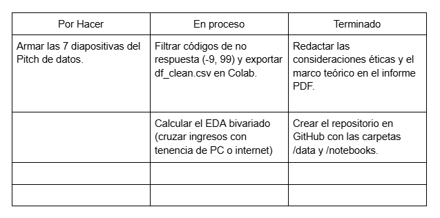

Soy Vanina Sotelo, estudiante de Ciencia de Datos en el Instituto IEA, con interés en el análisis estadístico y la interpretación de datos para la toma de decisiones.
Cuento con conocimientos básicos de Excel y Python, y actualmente me encuentro desarrollando habilidades en el procesamiento, limpieza y análisis de datos. Me interesa continuar ampliando mis conocimientos y aplicar herramientas que permitan obtener resultados claros, confiables y útiles.

Mi enfoque está orientado a colaborar en proyectos de análisis de datos, realizando tareas de organización, limpieza, procesamiento y análisis exploratorio mediante herramientas como Excel y Python.
Los servicios comprenden la elaboración de estadísticas descriptivas, tablas y visualizaciones que faciliten la interpretación y comunicación de resultados.
El alcance se limita al análisis descriptivo y exploratorio de datos, sin incluir el desarrollo de modelos predictivos avanzados ni la implementación de soluciones tecnológicas complejas.

Mi compromiso es comprender las necesidades y objetivos de cada cliente antes de comenzar un análisis, garantizando un tratamiento responsable y confidencial de la información.
Considero fundamental comunicar los resultados de manera clara, objetiva y transparente, reconociendo las limitaciones del análisis para contribuir a una toma de decisiones informada.

## Diccionario de variables.
El diccionario de variables documenta el significado, el tipo de dato y las categorías de cada campo, facilitando la interpretación y reproducibilidad del análisis.

CODUSU: Identificador único del hogar.

REGION:	Región geográfica del hogar. 1: GBA; 40: NOA; 41: NEA; 42: Cuyo; 43: Pampeana; 44: Patagonia.

IX_TOT:	Cantidad total de integrantes del hogar. Valores enteros mayores o iguales a 1.

NIVEL_ED	Nivel educativo del jefe/a del hogar.
          1: Primaria incompleta; 
          2: Primaria completa; 
          3: Secundaria incompleta; 
          4: Secundaria completa; 
          5: Superior/universitario completo;
          9: Sin respuesta.
          
ITF:	Ingreso total familiar.

DECIFR:	Decil de ingreso total familiar. Valores del 1 al 10; 1 representa los ingresos más bajos y 10 los más altos.

IV12_3:	Tenencia de computadora o laptop en el hogar. 1: Sí; 2: No; 9: Sin respuesta.

II7	Tenencia de conexión a internet fija en el hogar.	1: Sí; 2: No; 9: Sin respuesta.

## Tablero Kanban

