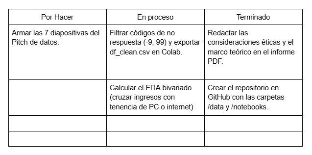

Soy Vanina Sotelo, estudiante de Ciencia de Datos en el Instituto IEA, con interés en el análisis estadístico y la interpretación de datos para la toma de decisiones.
Cuento con conocimientos básicos de Excel y Python, y actualmente me encuentro desarrollando habilidades en el procesamiento, limpieza y análisis de datos. Me interesa continuar ampliando mis conocimientos y aplicar herramientas que permitan obtener resultados claros, confiables y útiles.

Mi enfoque está orientado a colaborar en proyectos de análisis de datos, realizando tareas de organización, limpieza, procesamiento y análisis exploratorio mediante herramientas como Excel y Python.
Los servicios comprenden la elaboración de estadísticas descriptivas, tablas y visualizaciones que faciliten la interpretación y comunicación de resultados.
El alcance se limita al análisis descriptivo y exploratorio de datos, sin incluir el desarrollo de modelos predictivos avanzados ni la implementación de soluciones tecnológicas complejas.

Mi compromiso es comprender las necesidades y objetivos de cada cliente antes de comenzar un análisis, garantizando un tratamiento responsable y confidencial de la información.
Considero fundamental comunicar los resultados de manera clara, objetiva y transparente, reconociendo las limitaciones del análisis para contribuir a una toma de decisiones informada.

## Presentación del proyecto.

La brecha digital refleja las desigualdades en el acceso y uso de las Tecnologías de la Información y la Comunicación (TIC). En Argentina, estas diferencias pueden estar relacionadas con factores socioeconómicos, educativos y geográficos.
Este proyecto tiene como objetivo analizar las desigualdades en el acceso de los hogares a internet fijo y computadoras, con el propósito de aportar información que contribuya al diseño de políticas públicas de inclusión tecnológica.
Para el análisis se utilizan datos simulados, construidos tomando como referencia la estructura de la Encuesta Permanente de Hogares (EPH) del INDEC. El procesamiento y análisis de los datos se realizan mediante Python en Google Colab.

## guía de instalación/ejecución.

1. Primero para utilizar este proyecto se necesita:

 * Una cuenta de GitHub.
 * Acceso a Google Colab.
 * Conexión a Internet.

2. Obtener el repositorio

 Clonar o descargar el repositorio desde GitHub.

3. Abrir los notebooks

 Ingresar a Google Colab y abrir los archivos .ipynb disponibles en la carpeta /notebooks.

4. Cargar los datos.
   
El proyecto cuenta con dos archivos CSV disponibles en la carpeta data:

* eph_tecnologia_microdatos.csv: contiene los datos originales utilizados para el proceso de limpieza.

* df_clean.csv: contiene el conjunto de datos limpio, utilizado para los análisis estadísticos.

Los archivos necesarios deben cargarse en el entorno de ejecución de Google Colab según el notebook que se desee ejecutar.

*Nota:* Tener en cuenta que los archivos cargados manualmente en Google Colab se almacenan temporalmente en el entorno de ejecución.

5. Ejecutar el proyecto

 Ejecutar las celdas de los notebooks en orden, siguiendo las etapas del análisis:

* Limpieza y preparación de datos.

* Estadísticas descriptivas univariantes.

* Interpretación de resultados.

## Diccionario de variables.

El diccionario de variables documenta el significado, el tipo de dato y las categorías de cada campo, facilitando la interpretación y reproducibilidad del análisis.

CODUSU: Identificador único del hogar.

REGION:	Región geográfica del hogar. 1: GBA; 40: NOA; 41: NEA; 42: Cuyo; 43: Pampeana; 44: Patagonia.

IX_TOT:	Cantidad total de integrantes del hogar. Valores enteros mayores o iguales a 1.

NIVEL_ED	Nivel educativo del jefe/a del hogar.
          1: Primaria incompleta; 
          2: Primaria completa; 
          3: Secundaria incompleta; 
          4: Secundaria completa; 
          5: Superior/universitario completo;
          9: Sin respuesta.
          
ITF:	Ingreso total familiar.

DECIFR:	Decil de ingreso total familiar. Valores del 1 al 10; 1 representa los ingresos más bajos y 10 los más altos.

IV12_3:	Tenencia de computadora o laptop en el hogar. 1: Sí; 2: No; 9: Sin respuesta.

II7	Tenencia de conexión a internet fija en el hogar.	1: Sí; 2: No; 9: Sin respuesta.

## Tablero Kanban.

## Sintesis de hallazgos.

El análisis permitió identificar asociaciones entre las condiciones socioeconómicas y educativas y el acceso a las tecnologías en los hogares de la base de datos.
Los resultados muestran que los hogares con mayores ingresos presentan una mayor tenencia de computadoras o laptops, con una diferencia de 39,83 puntos porcentuales entre los grupos de ingresos extremos. El acceso a internet fijo aumenta con el nivel educativo del jefe del hogar, con una diferencia de 53,81 puntos porcentuales entre las categorías educativas extremas.
Los hogares que cuentan con internet fijo presentan una mayor tenencia de computadoras que aquellos que no disponen de conexión, con una diferencia de 14,43 puntos porcentuales.
Los resultados respaldan las tres hipótesis planteadas y evidencian que la brecha digital comprende distintas dimensiones, relacionadas con los recursos económicos, el nivel educativo y la disponibilidad de infraestructura tecnológica.
Los resultados corresponden exclusivamente a la base de datos simulada analizada y no representan estimaciones de la población argentina.

